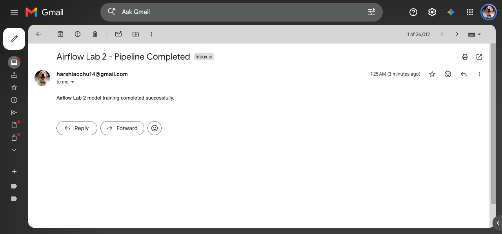
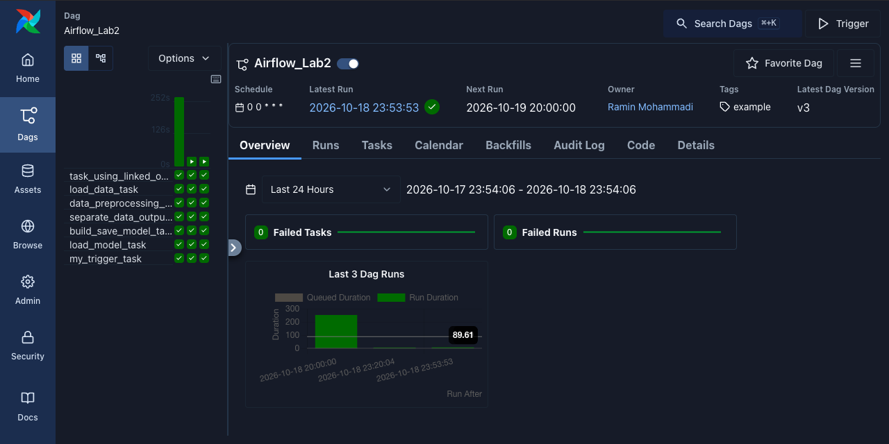
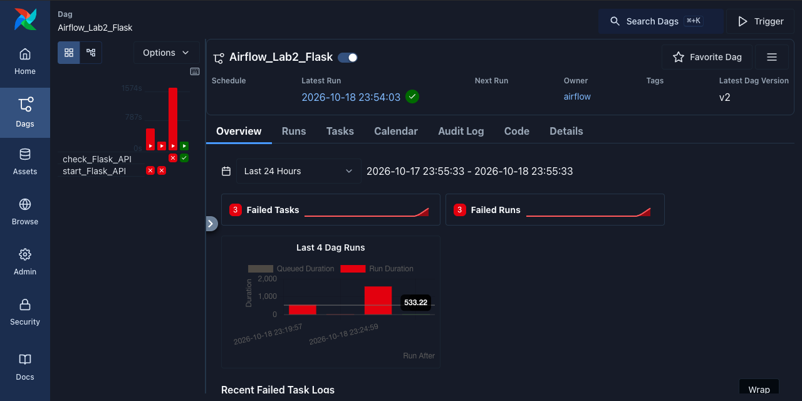
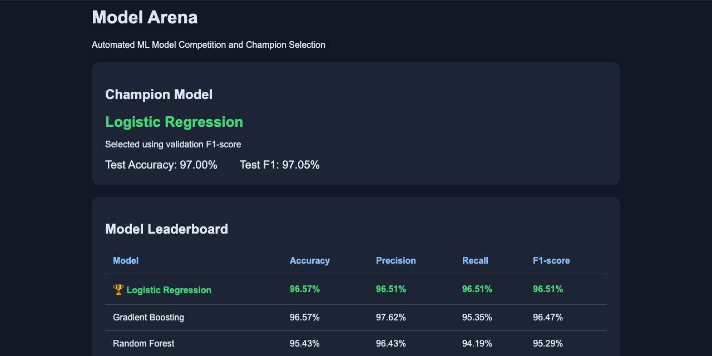

# Airflow Lab Instructions and Description

## Introduction
This document provides a detailed breakdown of the two DAGs (`Airflow_Lab2` and `Airflow_Lab2_Flask`) along with explanations of each function within the DAG files. These explanations aim to clarify the purpose and functionality of each task and function in the Airflow workflows.

Watch the tutorial video for this lab at [Airflow Lab2 Tutorial Video](https://youtu.be/LwBFOyfN5TY)

## Prerequisites
Before proceeding with this lab, ensure the following prerequisites are met:

- Basic understanding of Apache Airflow concepts.
- Apache Airflow installed and configured.
- Necessary Python packages installed, including Flask.

## Airflow Email Configuration

### Sign in with app passwords
Follow the instruction provided here: [link](https://support.google.com/accounts/answer/185833) and get your smtp password

### Adding SMTP Information to airflow.cfg

To configure Airflow to send emails, you need to add SMTP information to the `airflow.cfg` file. Follow these steps:

1. Locate the `airflow.cfg` file in your Airflow installation directory.
2. Open the file using a text editor.
3. Search for the `[smtp]` section in the configuration file.
4. Update the following parameters with your SMTP server information:
   - `smtp_host`: Hostname of the SMTP server.
   - `smtp_starttls`: Set it to `True` if your SMTP server uses TLS.
   - `smtp_ssl`: Set it to `True` if your SMTP server uses SSL.
   - `smtp_user`: Your SMTP username.
   - `smtp_password`: Your SMTP password.
   - `smtp_port`: Port number of the SMTP server (e.g., 587 for TLS, 465 for SSL).
5. Save the changes to the `airflow.cfg` file.

for our lab assuming you have a gmail account you can use the following setting:
   - smtp_host = smtp.gmail.com
   - smtp_starttls = True
   - smtp_ssl = False
   - smtp_user = YOUREMAIL@gmail.com
   - smtp_password = Enter your password generated above
   - smtp_port = 587
   - smtp_mail_from = YOUREMAIL@gmail.com
   - smtp_timeout = 30
   - smtp_retry_limit = 5

SMTP settings above describe the original lab's optional email configuration. Email notifications were tested successfully using the configured Gmail SMTP account.

## DAG Structure

### `Airflow_Lab2`
This DAG orchestrates a machine learning pipeline and notification system. Let's break down each function within this DAG:

1. **`notify_success(context)` and `notify_failure(context)` Functions:**
   - The success callback logs task completion, while the failure callback sends a notification. The separate `send_email` EmailOperator sends the pipeline completion email (using the locally configured sender/recipient account).

2. **`default_args` Dictionary:**
   - This dictionary defines default arguments for the DAG, including the start date and the number of retries in case of task failure.

3. **`dag` Definition:**
   - This section creates the main DAG instance (`Airflow_Lab2`) with various parameters such as description, schedule interval, catchup behavior, and tags.
   
4. **`owner_task` BashOperator:**
   - This task echoes `1` and is assigned to an owner (`Ramin Mohammadi`). It represents a simple demonstration task with a linked owner.

5. **`send_email` EmailOperator:**
   - The `send_email` EmailOperator sends a successful completion notification. A separate `notify_failure(context)` callback handles task-failure alerts. Both were tested.

6. **PythonOperator Tasks:**
   - These tasks execute Python functions (`load_data`, `data_preprocessing`, `separate_data_outputs`, `build_model`, `load_model`) representing different stages of a machine learning pipeline. They perform data loading, preprocessing, model building, and model loading tasks.

7. **`TriggerDagRunOperator` Task:**
   - This task triggers the `Airflow_Lab2_Flask` DAG upon successful completion of the main DAG. It triggers a health check of the separately running Flask dashboard after successful pipeline completion.

### `Airflow_Lab2_Flask`
This DAG manages the Flask API's lifecycle and consists of the following function:

1. **`check_dag_status()` Function:**
   - This function queries the status of the last DAG run (`Airflow_Lab2`). It returns `True` if the DAG run was successful, and `False` otherwise.

2. **`handle_api_request()` Function:**
   - This function handles API requests and redirects users to `/success` or `/failure` routes based on the status of the last DAG run.

3. **Flask Routes and HTML Templates:**
   - The Flask routes (`/api`, `/success`, `/failure`) define endpoints for accessing the API and displaying success or failure pages. These routes render HTML templates (`success.html`, `failure.html`) with appropriate messages.

4. **`start_flask_app()` Function:**
   - This function starts the Flask server, enabling users to access the API endpoints.

5. **`start_flask_API` PythonOperator:**
   - In this implementation, the `check_Flask_API` PythonOperator verifies the dedicated Flask Docker service. Docker starts the server independently.

## Conclusion
In this project, we've constructed a robust workflow using Apache Airflow to orchestrate a machine learning pipeline and manage a Flask API for monitoring purposes. The Airflow_Lab2 DAG coordinates various tasks, including data loading, preprocessing, model building, and email notification upon completion. By leveraging PythonOperators and BashOperator, we've encapsulated each step of the machine learning process, allowing for easy scalability and maintenance.

Additionally, the integration of email notifications enhances the workflow's visibility, providing stakeholders with timely updates on task success or failure. This ensures proactive monitoring and quick response to any issues that may arise during pipeline execution.

Furthermore, the Airflow_Lab2_Flask DAG facilitates the management of a Flask API, enabling users to access endpoints for checking the status of the machine learning pipeline. By querying the last DAG run status, the API delivers real-time feedback, empowering users to make informed decisions based on the pipeline's performance.

Overall, this project demonstrates the power of Apache Airflow in orchestrating complex workflows and integrating external systems seamlessly. By following the provided instructions and understanding the workflow's structure, users can leverage Airflow to streamline their machine learning pipelines and enhance operational efficiency.

---

# Airflow Lab 2: Model Arena

## Project Overview
Extended the original Apache Airflow advertising prediction pipeline into an automated model competition and champion selection system.

## Implementation Status

- Main ML DAG executed successfully in the local Docker environment.
- Three candidate models were evaluated and a champion selected.
- Flask Model Arena dashboard was tested locally.
- SMTP email notifications are implemented and tested using Airflow's EmailOperator.
- Flask runs as a dedicated Docker service; the Flask DAG performs a health check.
- Fresh-clone execution has not yet been independently verified.

## Original Modifications

1. Added Random Forest and Gradient Boosting alongside Logistic Regression.
2. Implemented automatic champion selection using validation F1-score.
3. Added a validation split for comparing candidate models.
4. Added accuracy, precision, recall, and F1 evaluation.
5. Retrained and saved the selected champion model.
6. Generated leaderboard.json containing model comparisons.
7. Created a new Flask dashboard at /leaderboard.
8. Removed duplicate feature scaling.
9. Updated Docker Compose configuration for persistent model artifacts.

## Model Comparison

| Model | Validation Accuracy | Validation F1 |
|---|---|---|
| Logistic Regression | 96.57% | 96.51% |
| Gradient Boosting | 96.57% | 96.47% |
| Random Forest | 95.43% | 95.29% |

## Champion Model

Selected Model: Logistic Regression

Selection Metric: Validation F1-score

Held-out Test Accuracy: 97.00%

Held-out Test F1-score: 97.05%

## Key Finding

Logistic Regression narrowly outperformed Gradient Boosting on validation F1-score, showing that more complex models do not always deliver better performance.

## Running the Project

1. Start Docker Desktop.
2. From Lab_2, run `docker compose up airflow-init` for first-time initialization.
3. Run `docker compose up -d`.
4. Open http://localhost:8080.
5. Trigger `Airflow_Lab2` in the Airflow UI.
6. Review model/leaderboard.json.
7. The dedicated `flask-dashboard` Docker service provides the dashboard at http://localhost:5555/leaderboard. The `Airflow_Lab2_Flask` DAG checks its health.

## Technologies

Apache Airflow 3.1.0, Docker Compose, Flask, scikit-learn, Python.

## Source

Adapted from Professor Ramin Mohammadi's MLOps Airflow Lab 2.

## SMTP Email Notifications

The ML DAG includes an `EmailOperator` task named `send_email`, which runs after successful model training and evaluation.

### Secure Configuration

Gmail SMTP uses port 587 with STARTTLS.

The following variables must be configured locally in the ignored `.env` file:

- `SMTP_EMAIL`: Gmail sender and recipient
- `SMTP_APP_PASSWORD`: Google app password
- `AIRFLOW_CONN_SMTP_DEFAULT`: Airflow SMTP connection URI

The Docker Compose override references these variables without storing actual credentials.

Email notifications are disabled by default unless `ENABLE_LAB2_EMAIL` is enabled. The recipient is restricted to the configured SMTP account.

The registered failure callback was invoked with a simulated task failure, and its email was received. No production task was deliberately failed.

### Execution Verification

The complete Airflow DAG executed successfully with all eight tasks green, including `send_email`.

## Execution Evidence

The following screenshots were captured from the local Docker environment after running the project.

### Successful ML Pipeline

### Flask DAG Execution

The latest Flask DAG run succeeded. Earlier failed attempts remain visible in the historical run overview.

### Model Arena Dashboard

## Quick Start and Environment Setup

### 1. Configure the environment

Create a `.env` file inside `Lab_2` if one does not already exist.

Set `AIRFLOW_UID=50000` on macOS. On Linux, use your UID from `id -u`.

Email notifications are optional. Set `ENABLE_LAB2_EMAIL=false` to run the pipeline without Gmail credentials.

To enable notifications, configure these variables in your private `.env`:

- `ENABLE_LAB2_EMAIL=true`
- `SMTP_EMAIL` with your Gmail account
- `SMTP_APP_PASSWORD` with your Google app password
- `AIRFLOW_CONN_SMTP_DEFAULT` with a valid Airflow SMTP connection URI

Never commit `.env` or your credentials.

### 2. Start the project

Run the following commands from `Lab_2`:

1. `docker compose config --quiet`
2. `docker compose up airflow-init`
3. `docker compose up -d`

Open Airflow at http://localhost:8080.

### 3. Run the ML pipeline

Enable `Airflow_Lab2` in the Airflow UI if it is paused, then trigger it manually.

The pipeline loads and preprocesses data, trains three models, selects the best one using validation F1-score, saves the model, and triggers `Airflow_Lab2_Flask`.

### 4. View the results

Open http://localhost:5555/leaderboard to see the model comparison dashboard.

The Flask server runs as a dedicated Docker service. The Flask DAG checks its health rather than starting a second Flask server.

### 5. Email notifications

When SMTP is enabled, a successful pipeline sends an email through `send_email`. The registered `notify_failure` callback sends an email when a task fails.

Both email delivery paths were verified locally. The failure notification was tested using a simulated failure context.

