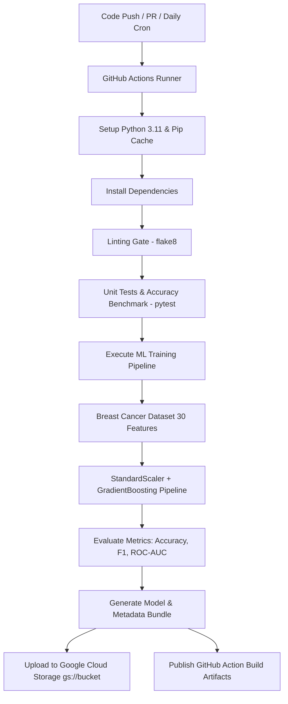

# GitHub Actions and GCP Connections: Automated ML Pipeline (Lab 3)

## Overview
This repository contains an automated Machine Learning operations (MLOps) pipeline integrating **GitHub Actions** with **Google Cloud Platform (GCP)** and **Google Cloud Storage (GCS)**.

The project demonstrates automated continuous integration, automated unit testing and quality gates, model training, comprehensive evaluation metrics logging, and model artifact versioning/deployment to GCS.

---

## 🌟 Summary of Custom Modifications & Enhancements

As required by the lab guidelines, several significant architectural, model, and CI/CD enhancements were implemented to transform the starter template into a production-grade MLOps workflow:

| Feature / Component | Original Starter Template | Custom Enhanced Implementation |
| :--- | :--- | :--- |
| **Dataset** | Iris dataset (150 samples, 4 features) | **Breast Cancer Wisconsin Diagnostic** (569 samples, 30 features, real-world clinical data) |
| **Model Architecture** | Basic `RandomForestClassifier` | **Scikit-Learn Pipeline (`StandardScaler` + `GradientBoostingClassifier`)** |
| **Data Leakage Prevention**| Unscaled / raw estimator | Standardized feature transformation encapsulated inside the inference pipeline |
| **Evaluation Metrics** | Accuracy only | **Accuracy, Precision, Recall, F1-Score, ROC-AUC, Confusion Matrix, & Classification Report** |
| **Metadata & Versioning** | Model file only | **`metadata.json` + Model `.joblib` bundle** with timestamps, hyperparameters, dataset stats, and metrics |
| **Storage Architecture** | Direct GCS upload only (fails offline) | **Dual Export**: Local artifact directory caching (`artifacts/`) + Resilient **GCS Cloud Upload** |
| **Automated Testing** | No unit tests | **Automated test suite (`pytest`)** validating data splits, pipeline training, accuracy thresholds (>90%), and model deserialization |
| **Code Quality & Linting**| No lint checks | Integrated **`flake8`** quality check in CI/CD pipeline |
| **CI/CD Pipeline** | Daily cron & manual dispatch | **Event-based triggers (`push`, `pull_request` on path filters), Python 3.11 setup, Caching, Linting, Testing gate, GCS Upload, & GitHub Action Artifact Publishing** |

---

## 🏗️ Pipeline Architecture



---

## 📊 Model Performance & Metrics

The pipeline trains a `GradientBoostingClassifier` within a pipeline containing `StandardScaler`. On the stratified test set (114 samples), the model achieves:

- **Accuracy**: `~95.61%`
- **Precision**: `~94.67%`
- **Recall**: `~98.61%`
- **F1-Score**: `~96.60%`
- **ROC-AUC**: `~99.07%`

### Exported Artifacts
Each run outputs two timestamped artifacts:
1. `trained_models/breast_cancer_gb_<TIMESTAMP>.joblib` — Serialized Scikit-Learn `Pipeline` object ready for serving.
2. `trained_models/breast_cancer_gb_meta_<TIMESTAMP>.json` — Full metadata file containing training parameters, dataset details, feature names, target names, and evaluation scores.

---

## 🛠️ Project Structure

```
.
├── README.md                  # Comprehensive documentation and changes
├── requirements.txt           # Project dependencies (pandas, scikit-learn, pytest, etc.)
├── pytest.ini                 # Pytest configuration
├── train_and_save_model.py    # Main training, evaluation, and artifact export script
├── test_train.py              # Automated unit tests for pipeline & benchmarks
├── workflows/
│   └── run.yaml               # GitHub Actions CI/CD workflow definition
└── artifacts/                 # Local directory for cached models and metadata
```

---

## 🚀 Getting Started Locally

### 1. Prerequisites
- Python 3.10+ or Python 3.11
- Git

### 2. Create Virtual Environment & Install Dependencies
```bash
# Create virtual environment
python3 -m venv .venv

# Activate environment
source .venv/bin/activate  # On Windows: .venv\Scripts\activate

# Install dependencies
pip install -r requirements.txt
```

### 3. Run Automated Tests
```bash
pytest test_train.py -v
```

### 4. Run Code Quality Checks
```bash
flake8 train_and_save_model.py test_train.py
```

### 5. Execute Model Training & Export
```bash
python train_and_save_model.py
```
> [!NOTE]
> If GCP credentials are not present locally, the pipeline will save model artifacts to the local `artifacts/` folder and gracefully log the cloud upload status.

---

## ☁️ Google Cloud Platform & GitHub Actions Setup

### Step 1: Create a GCP Project & Storage Bucket
1. Open the [Google Cloud Console](https://console.cloud.google.com/).
2. Create a new GCP project (or select an existing one).
3. Navigate to **Cloud Storage > Buckets** and click **Create**.
4. Choose a globally unique name (e.g., `my-mlops-models-bucket`).

### Step 2: Create a Service Account & Grant Permissions
1. Go to **IAM & Admin > Service Accounts**.
2. Click **Create Service Account** (e.g., `github-actions-sa`).
3. Grant the role **Storage Object Admin** (or `Storage Admin`) to allow uploading model blobs.
4. Click into the newly created service account > **Keys** tab > **Add Key** > **Create new key** (JSON).
5. Download the JSON key file securely.

### Step 3: Configure GitHub Repository Secrets
1. In your GitHub repository, navigate to **Settings > Secrets and variables > Actions**.
2. Add the following secrets:
   - `GCP_SA_KEY`: Paste the entire content of the downloaded Service Account JSON key.
   - `GCS_BUCKET_NAME`: *(Optional)* Name of your GCS bucket (defaults to `mlops-github-actions-harshitha` if omitted).

### Step 4: Run the GitHub Actions Workflow
- **Manual Trigger**: Go to the **Actions** tab on GitHub, select **Automated ML Training, Validation and GCS Artifact Pipeline**, and click **Run workflow**.
- **Automated Trigger**: Pushing changes to `Labs/Github_Labs/Lab3/**` or the daily midnight UTC cron trigger will automatically execute the pipeline.

---

## 🧪 Verification & Output

1. **GitHub Actions Logs**: Verify that all jobs (`Checkout`, `Lint Check`, `Unit Tests`, `Authenticate to GCP`, `Train and Export`, `Upload CI Build Artifacts`) pass with green checkmarks.
2. **GCS Bucket**: Check the `trained_models/` prefix in your bucket for the new `.joblib` model and `.json` metadata file.
3. **GitHub Artifacts**: Download the generated `trained-model-artifacts` zip file directly from the GitHub Actions run summary page.
