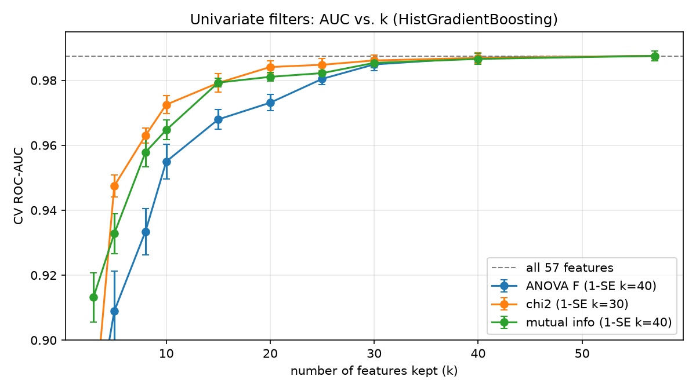
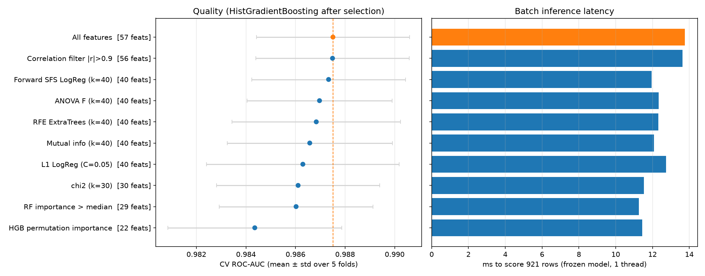

# Feature Selection Lab: Extended

This folder contains two notebooks:

| notebook | what it is |
|---|---|
| `Feature_Selection.ipynb` | The original ungraded lab (breast cancer, RandomForest). It was **fixed to run on current pandas/scikit-learn**: `df.drop(col, 1)` became `df.drop(columns=col)`, `DataFrame.append` became `pd.concat`, and `Series.iteritems` became `.items`. It is re-executed with its outputs saved. |
| `Feature_Selection_Extended.ipynb` | **My extension:** a new dataset, a new model, leakage-free evaluation, 10 selection methods, and a performance study. |

## What changed compared with the original lab

| | original | extension |
|---|---|---|
| Dataset | Breast Cancer Wisconsin (569 × 30) | **UCI Spambase** (4,601 × 57), downloaded by `src/get_data.py` |
| Model | RandomForestClassifier | **HistGradientBoostingClassifier** (RF and LogReg are kept as references) |
| Selection | run on the full data or before the split (leaks into evaluation) | each selector is a **`Pipeline` step** that is re-fit on every CV training fold |
| Evaluation | one 80/20 split (114 test rows) | 5-fold stratified CV, mean ± std, then **one** look at a locked 20% test set |
| ROC-AUC | from hard 0/1 predictions | from `predict_proba` |
| `k` | hard-coded at 20 | CV sweep plus the one-standard-error rule |
| Methods | correlation, ANOVA F, RFE, RF importance, L1 | the same, plus **chi², mutual information, forward SFS, HGB permutation importance**, and a correlation filter written as a transformer |
| Judged on | accuracy and F1 | accuracy **plus** fit time, retrain time, batch and single-row latency, model size, and selection **stability** (Jaccard similarity across folds) |
| Deployment | n/a | the selector is **frozen** into a column list plus the model for serving |

## Key results (from the executed notebook)

**1. The original results are within noise, and the original approach leaks.**
- On breast cancer, 5×5 repeated CV gives a fold standard deviation of about 2 accuracy points. The original methods differ by **one test patient** (0.9649 vs 0.9737).
- On pure random noise (true AUC = 0.5), selecting features on all rows and then cross-validating reports **AUC 0.875**. Running the same selection inside a Pipeline gives **0.60**, which is chance level within noise.

**2. The new model vs the original model (Spambase, all features, 5-fold CV)**

| model | ROC-AUC | F1 | accuracy |
|---|---|---|---|
| RandomForest (original) | 0.9860 | 0.937 | 0.951 |
| LogisticRegression | 0.9705 | 0.900 | 0.923 |
| **HistGradientBoosting** | **0.9875** | **0.946** | **0.958** |

**3. Choosing `k`.** chi² is clearly the best filter when few features are kept (AUC 0.948 with only 5 features, vs 0.909 for ANOVA F). All three filters converge by k ≈ 30–40. A fixed k=20 would cost 0.003–0.014 AUC.



**4. Quality and performance of the 10 methods**

| method | feats | CV AUC | stability | retrain (s) | batch 921 rows (ms) | 1 row (ms) | un-frozen pipeline (ms / KB) |
|---|---|---|---|---|---|---|---|
| All features | 57 | 0.9875 | 1.00 | 0.51 | 13.0 | 0.92 | 12.8 / 758 |
| Correlation filter \|r\|>0.9 | 55.6 | 0.9875 | 0.99 | 0.50 | 13.0 | 0.92 | 13.1 / 758 |
| Forward SFS LogReg (k=40) | 40 | 0.9873 | 0.72 | 0.37 | 11.7 | 0.89 | 11.9 / 740 |
| ANOVA F (k=40) | 40 | 0.9870 | 0.93 | 0.38 | 12.1 | 0.86 | 12.3 / 745 |
| **RFE ExtraTrees (k=40)** | 40 | 0.9868 | **0.97** | 0.39 | 12.2 | 0.86 | 12.1 / **24,060** |
| Mutual info (k=40) | 40 | 0.9866 | 0.84 | 0.38 | 12.5 | 0.86 | 12.2 / 744 |
| L1 LogReg (C=0.05) | 40 | 0.9863 | 0.89 | 0.39 | 12.9 | 0.88 | 12.5 / 745 |
| chi2 (k=30) | 30 | 0.9861 | 0.94 | 0.31 | 11.5 | 0.83 | 11.5 / 732 |
| RF importance > median | 29 | 0.9860 | 0.93 | 0.30 | 11.0 | 0.83 | **38.3** / **9,707** |
| HGB permutation importance | 22.2 | 0.9844 | 0.69 | 0.28 | 11.3 | 0.83 | 11.5 / 727 |

All timings are single-threaded medians on an Apple-silicon Mac, so they will vary between machines. The serving model is about 730–760 KB for every method.



**5. Final pick and test result.** The selection rule was fixed before opening the test set:
1. Keep methods within 1 SE of the best CV AUC.
2. Of those, keep methods with stability ≥ 0.7.
3. Pick the method with the fewest features, breaking ties by stability and then AUC.

The rule picks **RFE with ExtraTrees, 40 of 57 features**.

| locked test set | features | ROC-AUC | F1 | accuracy |
|---|---|---|---|---|
| All features | 57 | 0.9867 | 0.9352 | 0.9490 |
| RFE ExtraTrees (k=40) | 40 | 0.9855 | 0.9328 | 0.9468 |

A paired bootstrap of the AUC difference gives −0.0013, 95% CI [−0.0030, +0.0003], so the two are statistically indistinguishable.

### Performance takeaways
- For HistGradientBoosting, **selection buys cost, not accuracy.** No method beat all 57 features.
- Fewer features cut **retraining time by 25–45%** (0.51 s → 0.28–0.39 s). Single-row latency drops 5–10% and model size 2–4%, because HGB's cost depends on the number of trees, not the number of columns.
- **The biggest performance win was freezing the selector.** Shipping the fitted `SelectFromModel(RandomForest)` pipeline made inference **3.5× slower** than using no selection at all (38 ms vs 11 ms), because it recomputes forest importances on every `transform`. The RFE pipeline also pickles to **24 MB** because it carries its ExtraTrees model. Replacing either with a column list plus a refit model fixes both problems (11 ms, about 0.7 MB).
- Forward SFS was about 15× slower to run than the filters, and it was among the least stable methods.

## Running it
```bash
python3 -m venv .venv && source .venv/bin/activate
pip install -r requirements.txt
python src/get_data.py                      # writes data/spambase.csv (the notebook also does this if it is missing)
jupyter nbconvert --to notebook --execute --inplace Feature_Selection_Extended.ipynb   # about 5 min
python src/verify.py                        # independent check of the saved model and reported numbers
```

`src/verify.py` loads the saved model in a fresh process and checks that:
- it reproduces the test AUC, F1 and accuracy in `reports/final_result.md`
- it uses exactly the features in `reports/selected_features.txt`
- the leakage demo still shows the inflated AUC

It exits with code 0 when every check passes.

## Outputs
- `reports/method_comparison.csv`: every metric for every method
- `reports/k_sweep.csv`: AUC vs k for each filter
- `reports/final_result.md`: the chosen method and its test-set results
- `reports/selected_features.txt`: the final feature list
- `reports/figures/*.png`: the charts
- `src/fs_transformers.py`: the custom transformers (correlation filter, permutation-importance selector, serving column subset)
- `models/feature_selected_hgb.pkl`: the frozen serving model (git-ignored)
